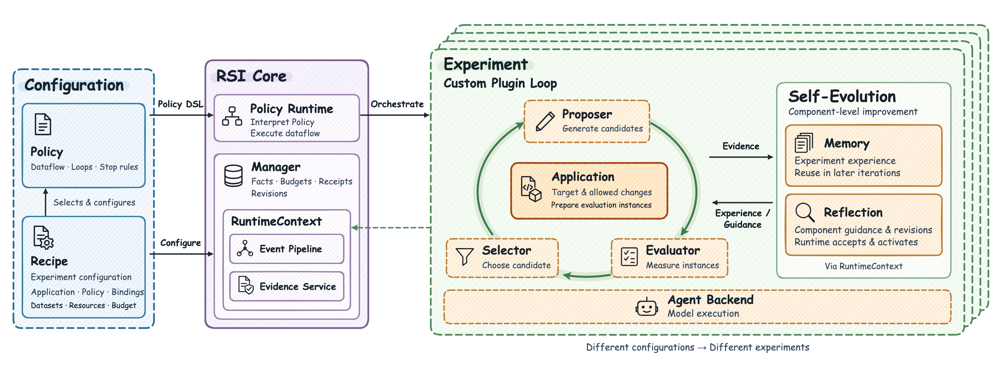

<h1 align="center">
  
</h1>

<h3 align="center">Multiple self-improvement strategies in one framework · Make Everything RSI-able.</h3>

<p align="center">
  Generate candidates, evaluate their performance, and iterate in one framework, from agent harnesses to AI infrastructure.
</p>

<p align="center">
  
  
  
</p>

<p align="center">
  English | <a href="./README.zh-CN.md">中文</a>
</p>

<p align="center">
  <a href="#overview">Overview</a> ·
  <a href="#architecture">How it works</a> ·
  <a href="#installation">Installation</a> ·
  <a href="#usage">Using ember-rsi</a> ·
  <a href="#web-workspace">Check experiment progress</a> ·
  <a href="#experiment-results">Experiment results</a> ·
  <a href="#user-guide">User guides</a>
</p>

<a id="overview"></a>

## ℹ️ Overview

`ember-rsi` is a pluggable framework for recursive self-improvement experiments on agents and AI infrastructure.

- **Recipe-driven self-improvement.** A declarative Recipe (`recipe.yaml`) connects an optimization target (Application), a strategy (Policy), and an Evaluator. Each experiment runs within explicit edit boundaries and a fixed budget.
- **Built-in strategies and extensions.** Run built-in strategies for agent harness optimization and inference parameter search. You can bring other targets into the same framework by defining allowed changes, generating candidates, and measuring their performance.
- **For developers and coding agents.** Developers can configure and run experiments from the CLI and inspect the results in the web viewer. Coding agents can use the same tools through the RSI Skill. Our goal is for them to plan, validate, run, and diagnose experiments, then choose the next step based on evaluation results within the scope and budget a developer authorizes.

<a id="architecture"></a>

## 🔄 How it works

<p align="center">
  <a href="docs/users/assets/rsi-architecture-handdrawn.svg">
    
  </a>
</p>

1. **Configure an experiment.** The Recipe selects the target and Policy and configures the dataset, plugins, and budget. The Policy defines the steps and stopping conditions.
2. **Run the RSI experiment.** The Runtime follows the Policy. A typical run starts from a baseline, proposes and validates edits, evaluates candidates, and uses the results to choose the next starting point.
3. **Improve the components.** The Policy can call Memory to preserve experience for later iterations and Reflection to propose changes to component prompts, resources, or configuration based on experiment feedback.

<a id="installation"></a>

## 📦 Installation and deployment

### Agent Instruction

Copy this instruction into your coding agent:

```text
Install the ember-rsi CLI and companion skill from https://github.com/evolving-foundry/ember-rsi.
Follow the README's manual CLI installation instructions: check prerequisites, clone the repository, install dependencies, build, and install the CLI.
Copy the complete skills/ember-rsi directory, including references and templates, into a skill directory supported by this agent. Ask before replacing an existing skill with the same name.
Run ember-rsi --help and confirm that this agent can discover and read the skill. Complete installation only; do not start experiments or make model calls.
```

### Manual Installation

#### 1. Install the CLI

Requirements

1. **Node.js** >= 24.19.0 and < 25.
2. **pnpm** 11.22.0.
3. **Git**, required to fetch the AgentBundle and Evaluator SDK dependencies.

```sh
# Clone and build ember-rsi.
git clone git@github.com:evolving-foundry/ember-rsi.git
cd ember-rsi
pnpm install --frozen-lockfile
pnpm build
pnpm add -g .

# Verify that the built CLI is available.
ember-rsi --help
```

#### 2. Install the skill

Run this from your target project and select the coding agent to install to:

```sh
npx skills add evolving-foundry/ember-rsi --skill ember-rsi
```

Add `-g` for a user-wide installation. Reload or restart your agent as required, then confirm that it can discover and read the `ember-rsi` skill.

<a id="usage"></a>

## 🛠️ Using ember-rsi

<a id="quickstart"></a>

### Quick start

#### 1. Configure models and the evaluation environment

This walkthrough uses the WorkBuddy Office scenario from the [Harness² example](examples/harness/dsh-harness2/README.md). Follow the [Evaluator's WorkBuddy setup guide](https://gitcode.com/Ascend/AscendAgent-Evaluator/blob/master/docs/users/benchmarks/workbuddy.md) to prepare Docker, the dataset, and container images. Make sure both the host and the evaluation containers can reach the model endpoint.

Expand the option for your system and replace the placeholders with your settings.

<details>

<summary>Linux / macOS / WSL (Bash)</summary>

```bash
# Set these variables in the terminal where you run ember-rsi. ember-rsi does not load .env files automatically.

# Optimizer model used to propose candidate changes.
export MODEL_NAME="your-optimizer-model"

# Model used by the evaluated agent. There is no fixed default.
# Set this to a model supported by your endpoint.
export EVALUATOR_MODEL_NAME="your-evaluation-model"

# Endpoint and API key shared by both models by default.
export MODEL_ENDPOINT="https://your-model-service.example/v1"
export MODEL_API_KEY="your-api-key"
```

</details>

<details>

<summary>Windows (PowerShell)</summary>

```powershell
# Set these variables in the terminal where you run ember-rsi. ember-rsi does not load .env files automatically.

# Optimizer model used to propose candidate changes.
$env:MODEL_NAME = 'your-optimizer-model'

# Model used by the evaluated agent. There is no fixed default.
# Set this to a model supported by your endpoint.
$env:EVALUATOR_MODEL_NAME = 'your-evaluation-model'

# Endpoint and API key shared by both models by default.
$env:MODEL_ENDPOINT = 'https://your-model-service.example/v1'
$env:MODEL_API_KEY = 'your-api-key'
```

</details>

#### 2. Validate, run, and resume an experiment

The Harness² example optimizes an AgentBundle baseline across 10 tasks, with up to 40 evaluations and a 72-hour time budget. For a first run, keep just the first task in `policy.config.dataset.taskIds` in [`recipe.yaml`](examples/harness/dsh-harness2/recipe.yaml).

```sh
# Validate the Recipe without starting the experiment.
ember-rsi validate examples/harness/dsh-harness2/recipe.yaml

# Start the experiment with this ID. This makes real model calls.
ember-rsi run examples/harness/dsh-harness2/recipe.yaml --id my-harness2-task

# Inspect the recorded status and results by experiment ID.
ember-rsi show my-harness2-task
```

- Candidates, evaluation metrics, call receipts, and evidence are stored in `.rsi/` in the current directory by default. Review the evaluation status, scores, and deliverables together.
- For details, see the [getting started guide](docs/users/getting-started.md), [Reflection guide](docs/users/guides/reflection.md), and [runtime events guide](docs/users/guides/runtime-events.md).

Resume an interrupted experiment from the original working directory using the same Recipe and experiment ID.

```sh
# Resume from the saved checkpoint.
ember-rsi run examples/harness/dsh-harness2/recipe.yaml --id my-harness2-task --resume
```

##### Built-in RSI strategies

Choose a strategy for your optimization target and follow its example to set up the environment, validate the Recipe, and run the experiment.

| Policy ID                 | How it improves the target                                                                                                                                | Example                                                                        |
| ------------------------- | --------------------------------------------------------------------------------------------------------------------------------------------------------- | ------------------------------------------------------------------------------ |
| `policy.harness2`         | Proposes and evaluates general (INV), domain-specific (DOM), and combined (Compose) changes, then compares their deliverables anonymously.                | [DSH Harness²](examples/harness/dsh-harness2/README.md)                        |
| `policy.wikiskill`        | Consolidates training experience into a wiki and proposes skill edits. Only candidates that improve on the validation set advance to independent testing. | [DSH WikiSkill](examples/harness/dsh-wikiskill/README.md)                      |
| `policy.parameter-grid`   | Enumerates a JSON parameter grid in declaration order to find the highest-throughput configuration that meets constraints such as latency SLOs.           | [Inference grid search](examples/artifacts/inference/parameter-grid/README.md) |
| `policy.parameter-optuna` | Searches inference parameters with Optuna TPE or random sampling and supports constraint-aware sampling and recovery by replaying trial history.          | [Inference TPE search](examples/artifacts/inference/parameter-tpe/README.md)   |

<a id="extensions"></a>

### Extending ember-rsi

#### For developers

Start with Recipe configuration and extend the framework as needed. See the examples for [writing Policies](docs/users/guides/writing-policies.md) and [writing plugins](docs/users/guides/writing-plugins.md).

| Goal                                                              | Extension point                                                                                                                                       |
| ----------------------------------------------------------------- | ----------------------------------------------------------------------------------------------------------------------------------------------------- |
| Change the dataset, models, budget, or plugin bindings            | Update or override the relevant `recipe.yaml` settings and `bindings`.                                                                                |
| Add a search loop, concurrent branches, or stopping conditions    | Write and register an `rsi.policy/v1` YAML Policy.                                                                                                    |
| Add an optimization target, proposer, evaluator, or agent backend | Implement a public contract from `ember-rsi/contracts` and register the implementation through `--plugin-dir <dir>` or in the application entrypoint. |
| Host experiments in another platform or service                   | Embed the Runtime with the Node.js APIs `createRuntime` and `validateRecipe`.                                                                         |

#### For AI coding agents

Load the RSI Skill in a coding agent and provide the optimization goal, permitted edits, and budget. The agent can choose or write a Recipe, validate the configuration, and, once authorized, run the experiment, inspect results, and diagnose failures.

- The [RSI Skill entrypoint](skills/ember-rsi/SKILL.md) uses the reference material and templates in the full `skills/ember-rsi/` directory. Use the [minimal example](skills/ember-rsi/references/quickstart.md) to check that the Recipe and plugins work together.

<a id="web-workspace"></a>

## 🖥️ Check experiment progress

Run both commands from the same directory where you ran `ember-rsi run`. They read experiment data from that directory's `.rsi/` folder.

To check an experiment's status in the terminal, pass its ID to `show`.

```sh
ember-rsi show my-harness2-task
```

To view progress in the browser, start the local read-only dashboard and open the address printed in the terminal.

```sh
ember-rsi dashboard
```

<a id="experiment-results"></a>

## 📊 Experiment results

<table>
  <thead>
    <tr>
      <th>Benchmark</th>
      <th>Target Agent</th>
      <th>Method</th>
      <th>Benchmark score</th>
    </tr>
  </thead>
  <tbody>
    <tr>
      <th rowspan="3"><a href="https://github.com/Tencent/workbuddy-bench#overview">WorkBuddy Bench</a><br>Code Subset</th>
      <td rowspan="3" align="center"><a href="https://github.com/deepseek-ai/deepseek-harness">DSH</a></td>
      <td><a href="https://arxiv.org/abs/2608.27454">WikiSkill</a><br><sub>10 training tasks / 5 validation tasks</sub></td>
      <td align="center">92.9% → 96.0% </td>
    </tr>
    <tr>
      <td><a href="https://github.com/google-research/harness2">Harness²</a><br><sub>10 validation tasks</sub></td>
      <td align="center">78.5% → 71.8% </td>
    </tr>
    <tr>
      <td><a href="https://arxiv.org/abs/2507.19457">GEPA</a></td>
      <td align="center"></td>
    </tr>
    <tr>
      <th rowspan="3"><a href="https://github.com/Tencent/workbuddy-bench#overview">WorkBuddy Bench</a><br>Office Subset</th>
      <td rowspan="3" align="center"><a href="https://github.com/deepseek-ai/deepseek-harness">DSH</a></td>
      <td><a href="https://arxiv.org/abs/2608.27454">WikiSkill</a><br><sub>10 training tasks / 5 validation tasks</sub></td>
      <td align="center">72.3% → 91.4% </td>
    </tr>
    <tr>
      <td><a href="https://github.com/google-research/harness2">Harness²</a><br><sub>10 validation tasks</sub></td>
      <td align="center">76.1% → 79.8% </td>
    </tr>
    <tr>
      <td><a href="https://arxiv.org/abs/2507.19457">GEPA</a></td>
      <td align="center"></td>
    </tr>
    <tr>
      <th rowspan="3"><a href="https://www.tbench.ai/news/terminal-bench-4-0">Terminal-Bench 4.0</a></th>
      <td rowspan="3" align="center"><a href="https://github.com/deepseek-ai/deepseek-harness">DSH</a></td>
      <td><a href="https://arxiv.org/abs/2608.27454">WikiSkill</a></td>
      <td align="center">-</td>
    </tr>
    <tr>
      <td><a href="https://github.com/google-research/harness2">Harness²</a></td>
      <td align="center"></td>
    </tr>
    <tr>
      <td><a href="https://arxiv.org/abs/2507.19457">GEPA</a></td>
      <td align="center"></td>
    </tr>
    <tr>
      <th rowspan="2"><a href="https://github.com/SWE-bench/SWE-bench">SWE-bench Verified</a></th>
      <td rowspan="2" align="center"><a href="https://github.com/deepseek-ai/deepseek-harness">DSH</a></td>
      <td><a href="https://github.com/google-research/harness2">Harness²</a><br><sub>20 training tasks</sub></td>
      <td align="center">-</td>
    </tr>
    <tr>
      <td><a href="https://arxiv.org/abs/2608.27454">WikiSkill</a><br><sub>20 training tasks / 10 validation tasks</sub></td>
      <td align="center">-</td>
    </tr>
  </tbody>
</table>

- Scores show baseline → evolved agent, with changes in percentage points (pp).

<a id="user-guide"></a>

## 📖 User guides

- [Getting started](docs/users/getting-started.md) for writing a first Recipe and finding follow-on guides
- [Architecture and core concepts](docs/users/concepts/architecture.md) for the roles of Applications, Policies, plugins, and the Runtime
- [Reflection guide](docs/users/guides/reflection.md) for improving component guidance
- [Runtime events](docs/users/guides/runtime-events.md) for event subscriptions and extensions
- Complete experiment Recipes for [DSH Harness²](examples/harness/dsh-harness2/README.md), [DSH WikiSkill (Terminal-Bench 4.0)](examples/harness/dsh-wikiskill/README.md), [vLLM grid search](examples/artifacts/inference/parameter-grid/README.md), and [vLLM TPE search](examples/artifacts/inference/parameter-tpe/README.md)

## 🙏 Acknowledgments

Thanks to the Cordis maintainers and contributors. ember-rsi uses Cordis to register plugins, isolate experiment contexts, and dispatch runtime events. [Cordis project](https://github.com/cordiverse/cordis)
