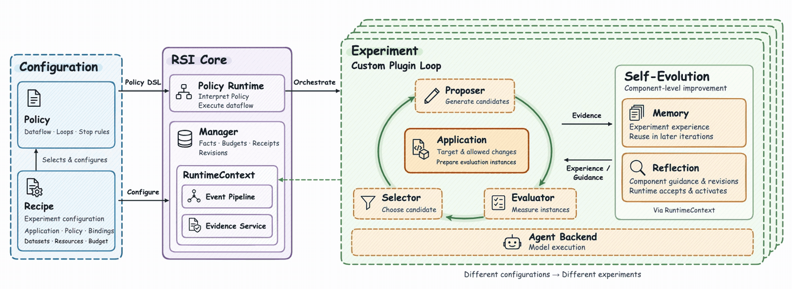
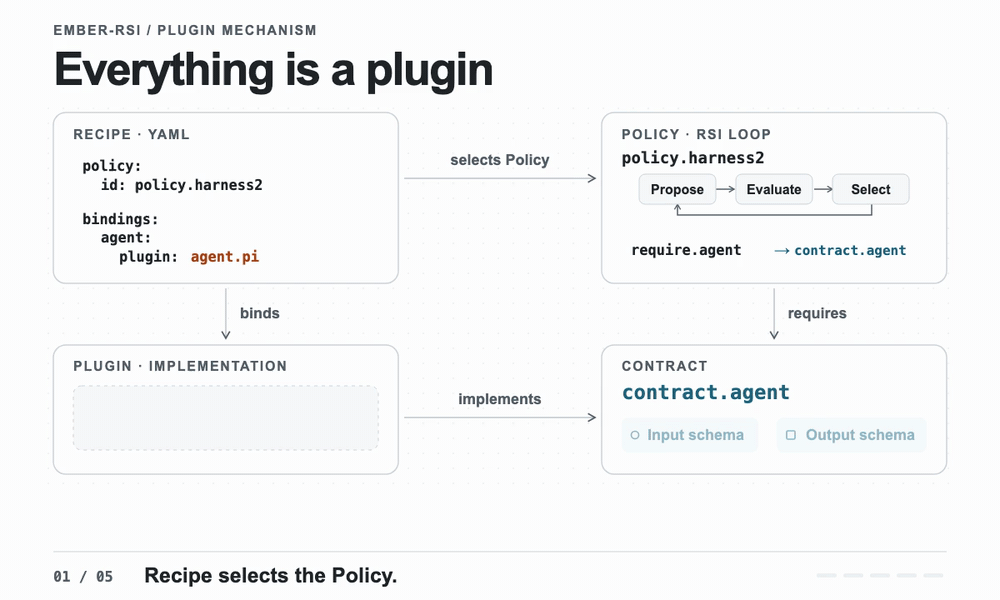

# 

### 多种自演进策略，一个框架统一承载 · Make Everything RSI-able.

从 Agent Harness 到 AI 基础设施，用同一套框架生成候选方案、评测效果并持续迭代。


[English](./README.md) | 中文

[简介](#overview) · [工作原理](#architecture) · [一切皆插件](#extensions) · [安装与部署](#installation) · [使用 ember-rsi](#usage) · [内置 RSI 策略](#built-in-rsi-strategies) · [使用指南](#user-guide)


## ℹ️ 简介

`ember-rsi` 是面向 Agent 和 AI 基础设施的插件化递归自改进（RSI）实验框架。

- **由 Recipe 驱动自演进**。声明式 Recipe（`recipe.yaml`）连接优化目标（Application）、策略（Policy）和评测器（Evaluator）。每次实验都有明确的修改范围和固定预算。
- **内置策略与扩展能力**。框架内置 Agent Harness 优化和推理参数搜索策略。为其他目标定义允许的修改、生成候选方案并衡量效果，即可将其接入同一框架。
- **面向开发者和编程 Agent**。开发者可通过 CLI 配置和运行实验，并在网页中查看结果。编程 Agent 可通过 RSI Skill 使用同一套工具。我们希望它们能在开发者授权的范围和预算内规划、校验、运行实验，诊断失败，并根据评测结果决定下一步。


## 🔄 工作原理

### 架构总览



1. **定义优化目标。** 在 Recipe 中选择 Application，指定基线和允许修改的范围。Application 还决定如何把候选版本实例化，供 Evaluator 评测。
2. **运行优化循环。** Runtime 按 Policy 执行。Application 初始化基线，校验并提交 Proposer 提出的改动，并为 Evaluator 提供和释放实例。Selector 根据评测结果或交付物选择下一轮的起点。
3. **让组件自进化。** Policy 可调用 Memory 沉淀实验经验，也可调用 Reflection 根据执行证据改进组件的提示词、资源或配置。


### 一切皆插件



*Harness² 示例 ·* `application.agentbundle` *管理优化对象及其评测实例。Recipe 可独立切换 Agent 后端。*

- **Application（优化目标与实例化）** 是 Recipe 在 `application` 下选择的核心插件。它定义优化什么、允许改动什么，以及如何为评测准备和释放候选实例。内置实现可管理 AgentBundle、推理服务配置或 Triton-Ascend 算子。
- **Policy（优化策略）** 定义 RSI 循环、停止条件，以及各插件绑定所需的契约。
- **Plugin（插件）** 实现一个契约。契约规定输入和输出，满足同一契约的实现可以替换。
- **Recipe（实验配方）** 选择 Application 和 Policy，为流程绑定具体插件，并提供配置和预算。
- [选择 Application](docs/users/guides/built-in-components_zh.md#application)
- [编写 Policy](docs/users/guides/writing-policies_zh.md)
- [编写插件](docs/users/guides/writing-plugins_zh.md)
- [用 Recipe 组装实验](docs/users/guides/configuration_zh.md#recipe-字段与绑定覆盖)


## 📦 安装与部署


### 编程 Agent 安装指令

将下面这段指令复制给你的编程 Agent：

```text
请从 https://github.com/evolving-foundry/ember-rsi 安装 ember-rsi CLI 和配套 skill。
按照 README 中的 CLI 手动安装说明，检查前置依赖、克隆仓库、安装依赖、构建并安装 CLI。
将完整的 skills/ember-rsi 目录（包括引用资料和模板）复制到当前 Agent 支持的 skill 目录，替换同名 skill 前先询问。
运行 ember-rsi --help，并确认当前 Agent 能发现和读取该 skill。本次只完成安装，不启动实验或调用模型。
```


### 手动安装


#### 1. 安装 CLI

环境要求

1. **Node.js** >= 24.19.0 且 < 25。
2. **pnpm** 11.22.0。
3. **Git**，用于拉取 AgentBundle 和 Evaluator SDK 依赖。

```sh
# 克隆并构建 ember-rsi。
git clone git@github.com:evolving-foundry/ember-rsi.git
cd ember-rsi
pnpm install --frozen-lockfile
pnpm build
pnpm add -g .

# 检查安装后的 CLI 是否可用。
ember-rsi --help
```


#### 2. 安装 skill

在目标项目目录执行以下命令，并选择要安装到的编程 Agent：

```sh
npx skills add evolving-foundry/ember-rsi --skill ember-rsi
```

如需用户级安装，添加 `-g`。按 Agent 的要求重新加载或重启，然后确认能发现和读取 `ember-rsi` skill。

将 RSI Skill 加载到支持 Skill 的编程助手后，可以直接交代优化目标、允许修改的范围和预算，让助手选择或编写 Recipe、校验配置，并在授权后运行实验、检查结果和诊断失败。

- **RSI Skill** 的入口是 `[SKILL.md](skills/ember-rsi/SKILL.md)`。加载时请保留整个 `skills/ember-rsi/` 目录，以便助手访问参考文档和模板。可先用[最小示例](skills/ember-rsi/references/quickstart.md)验证配方和插件能否正常协作。

后续命令均在 `ember-rsi` 仓库根目录执行，使用已安装的 `ember-rsi` CLI。


## 🛠️ 使用 ember-rsi


### 快速开始


#### 1. 配置模型与评测环境

下面以 [Harness² 示例](examples/harness/dsh-harness2/README.md)（WorkBuddy Office 场景）为例。请先按 Evaluator 的 [WorkBuddy 配置说明](https://github.com/evolving-foundry/ember-evaluator/blob/master/docs/users/benchmarks/workbuddy.zh-CN.md) 准备 **Docker**、题库与容器镜像，并确保宿主机与评测容器均可访问模型服务地址。

```bash
# 在运行 ember-rsi 的同一个终端中显式设置变量，ember-rsi 不会自动读取 .env 文件。

# 优化器模型，用于生成候选修改。
export MODEL_NAME="your-optimizer-model"

# 被测 Agent 使用的模型，无固定默认值。
# 请填写模型服务支持的模型名称。
export EVALUATOR_MODEL_NAME="your-evaluation-model"

# 优化器和评测模型默认共用的服务地址与 API 密钥。
export MODEL_ENDPOINT="https://your-model-service.example/v1"
export MODEL_API_KEY="your-api-key"
```


#### 2. 校验、运行与续跑实验

Harness² 默认在 10 个任务上优化 AgentBundle 基线（最多 40 次评测、72 小时实验总时限）。首次试跑可先在 `[recipe.yaml](examples/harness/dsh-harness2/recipe.yaml)` 的 `policy.config.dataset.taskIds` 中只保留第一道题：

```sh
# 校验实验配方，不启动实验。
ember-rsi validate examples/harness/dsh-harness2/recipe.yaml

# 以 my-harness2-task 为实验 ID 启动实验，会发起真实模型调用。
ember-rsi run examples/harness/dsh-harness2/recipe.yaml --id my-harness2-task
```

- 候选版本、评测指标、调用收据与证据默认保存在当前目录的 `.rsi/` 下，请结合评测状态、得分和交付物判断实验结果。
- 详细用法见 `docs/users` 下的 [快速入门](docs/users/getting-started_zh.md)、[Reflection 指南](docs/users/guides/reflection_zh.md) 和 [运行时事件说明](docs/users/guides/runtime-events_zh.md)。

若实验中断，可在原工作目录使用相同的 Recipe 和实验 ID 断点续跑。

```sh
# 从已保存的检查点续跑。
ember-rsi run examples/harness/dsh-harness2/recipe.yaml --id my-harness2-task --resume
```


### 查看实验进度

下面两个命令都要在执行 `ember-rsi run` 的同一个目录下运行。它们从该目录下的 `.rsi/` 读取实验数据。

在终端查看实验状态时，把实验 ID 传给 `show`。

```sh
ember-rsi show my-harness2-task
```

也可以启动本地只读 Dashboard，然后在浏览器打开终端显示的地址，查看实验进度。

```sh
ember-rsi dashboard
```

## 内置 RSI 策略


| Policy                    | 如何优化目标                                    | 示例Recipe                                                                        | 可替换插件                                                                                                                                                                                                                                              |
| ------------------------- | ----------------------------------------- | ------------------------------------------------------------------------------- | -------------------------------------------------------------------------------------------------------------------------------------------------------------------------------------------------------------------------------------------------- |
| `policy.harness2`         | 评测通用、领域和组合改进，再匿名比较交付物。                    | [DSH Harness²](examples/harness/dsh-harness2/README.md)                         | `[agent.pi](src/plugins/agent-pi)`, `[proposer.agent](src/plugins/proposer-agent)`, `[evaluator.agentbench](src/plugins/evaluator-agentbench)`†, `[selector.artifact](src/plugins/selector-artifacts)`, `[memory.agent](src/plugins/memory-agent)` |
| `policy.wikiskill`        | 将训练经验汇总到 Wiki，在验证集上有所改善的 Skill 修改才进入独立测试。 | [DSH WikiSkill](examples/harness/dsh-wikiskill/README.md)                       | `[agent.pi](src/plugins/agent-pi)`, `[proposer.agent](src/plugins/proposer-agent)`, `[memory.agent](src/plugins/memory-agent)`, `[evaluator.agentbench](src/plugins/evaluator-agentbench)`†, `[selector.metric](src/plugins/selector-metrics)`     |
| `policy.parameter-grid`   | 在参数网格中寻找满足延迟 SLO 等约束的最高吞吐配置。              | [推理参数网格搜索](examples/artifacts/inference/parameter-grid/README.md)               | `[proposer.grid](src/plugins/proposer-grid)`, `[evaluator.inferencebench](src/plugins/evaluator-inferencebench)`†, `[selector.metric](src/plugins/selector-metrics)`                                                                               |
| `policy.parameter-optuna` | 用 Optuna TPE 或随机采样搜索推理参数。                 | [推理参数 TPE 搜索](examples/artifacts/inference/parameter-tpe/README.md)             | `[proposer.optuna](src/plugins/proposer-optuna)`, `[evaluator.inferencebench](src/plugins/evaluator-inferencebench)`†, `[selector.metric](src/plugins/selector-metrics)`                                                                           |
| `policy.operator-search`  | 搜索 Triton-Ascend 算子改进方案，并独立复评选中的候选方案。     | [Transpose-copy 算子优化](examples/artifacts/kernel/transpose-copy/README.zh-CN.md) | `[agent.pi](src/plugins/agent-pi)`†, `[proposer.operator](src/plugins/proposer-operator)`, `[evaluator.operatorbench](src/plugins/evaluator-operatorbench)`†, `[selector.metric](src/plugins/selector-metrics)`†                                   |


† 表示插件由示例 Recipe 指定。


## 📖 使用指南

- [快速入门](docs/users/getting-started_zh.md)
- [架构与核心概念](docs/users/concepts/architecture_zh.md)
- [内置组件](docs/users/guides/built-in-components_zh.md)
- [配置实验](docs/users/guides/configuration_zh.md)
- [运行与检查实验](docs/users/guides/running-experiments_zh.md)
- [使用 Skill](docs/users/guides/using-skills_zh.md)
- [Memory 使用指南](docs/users/guides/memory_zh.md)
- [Reflection 使用指南](docs/users/guides/reflection_zh.md)
- [编写 Policy](docs/users/guides/writing-policies_zh.md)
- [编写插件](docs/users/guides/writing-plugins_zh.md)
- [事件系统开发指南](docs/users/guides/runtime-events_zh.md)


## 🙏 致谢

感谢 [Cordis 项目](https://github.com/cordiverse/cordis) 的维护者和贡献者，ember-rsi 使用 Cordis 注册插件、隔离实验上下文和分发运行时事件。