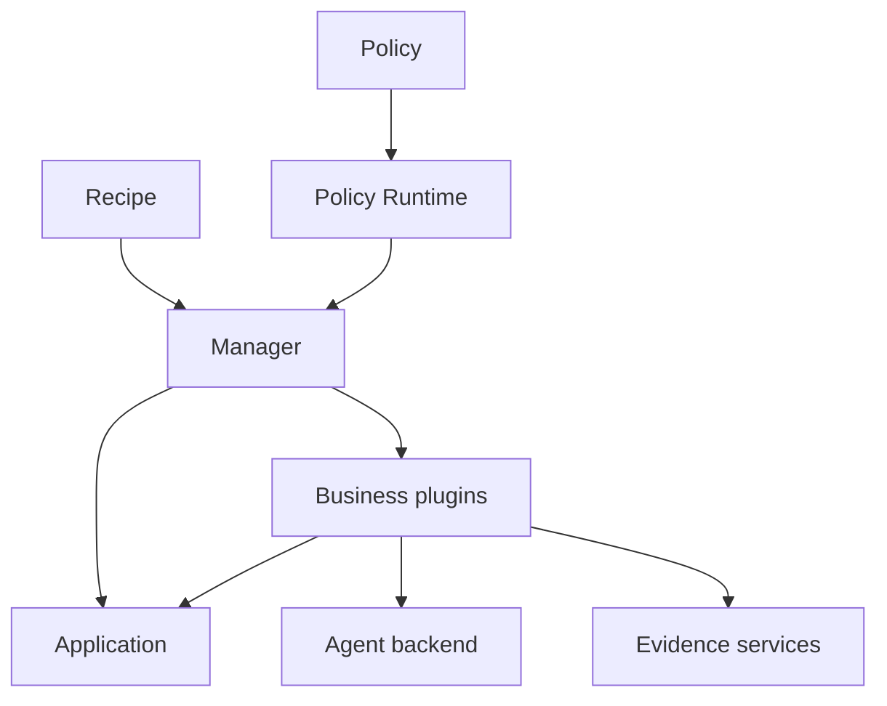
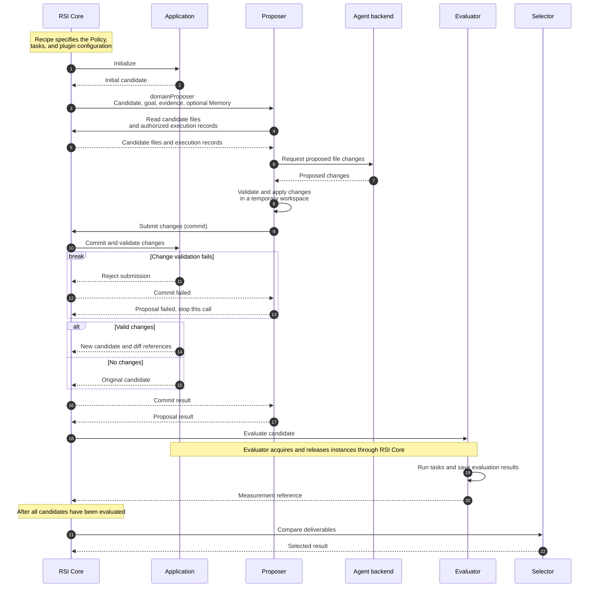

# Architecture and core concepts

English | [简体中文](architecture_zh.md) · [Getting started](../getting-started.md)

ember-rsi (Recursive Self-Improvement) is a pluggable framework for recursive self-improvement experiments on agents and AI infrastructure.

- Configuration specifies the optimization target, execution flow, plugins, and budgets.
- RSI Core runs and manages an Experiment from that configuration, recording its state and results.
- The same RSI Core can run different Experiments with different Configurations.

## Core concepts

| Concept             | Responsibility                                                                                                                                 |
| ------------------- | ---------------------------------------------------------------------------------------------------------------------------------------------- |
| Application         | Manage the optimization object, allowed changes, candidate initialization and commits, and execution-instance acquisition/release.             |
| Plugin              | Implement one public capability such as proposing, evaluating, selecting, maintaining Memory, or generating Reflection proposals.              |
| Policy              | Orchestrate calls, state, conditions, loops, and stopping rules using YAML dataflow.                                                           |
| Recipe              | Select an Application and Policy, supply configuration and bindings, and set experiment budgets.                                               |
| Runtime and Manager | Register plugins and Policies, compile dataflow, and manage facts, budgets, call receipts, instance leases, revision activation, and recovery. |

## Contract, Schema, and Binding

> Contract, Schema, and Binding decouple a Policy from concrete plugin implementations, making it easier to swap plugins, adjust configuration, and reuse the same flow in experiments with different plugin implementations.

A **Contract** specifies the inputs and outputs shared by a class of plugins, using schemas to define their fields, types, and constraints. Each plugin provides the logic that turns inputs into outputs.

- A plugin declares the [public contract](../../../src/contracts/plugin-types/index.ts) it follows. The Runtime validates inputs and outputs against that contract, allowing the same Policy to switch between plugin implementations that follow it.

- For example, [`contract.proposer`](../../../src/contracts/plugin-types/proposer.ts) defines a parent candidate, goal, and evidence references as inputs, and a candidate reference and change details as outputs.

A **Schema** describes fields, types, required values, and value constraints. Schemas can be declared in JSON/YAML or defined directly as TypeScript objects; both use JSON Schema rules.

- The Runtime uses schemas to validate actual data, while TypeScript types provide compile-time checks.
- Common Schema categories:

  | Schema                                  | Owner                          | Purpose                                                                       |
  | --------------------------------------- | ------------------------------ | ----------------------------------------------------------------------------- |
  | Plugin input/output                     | Public contract                | Define the data exchanged with every implementation of that capability.       |
  | Plugin configuration                    | Concrete plugin implementation | Define settings accepted by that implementation, including declared defaults. |
  | Policy input/configuration/state/output | Policy                         | Define the data accepted, maintained, and returned by the flow.               |

A **Binding** connects a logical name in a Policy to a registered plugin implementation and its configuration. Its `config` field supplies the implementation's settings.

- For example, `require.domainProposer` requires `contract.proposer`. This action can use `proposer.agent` to generate proposals with a model, or a custom plugin that follows the same contract and generates proposals from rules, without changing the Policy flow.

## Candidate, Artifact, and Measurement

The flow passes optimization objects and results through shared data models:

| Concept     | Meaning                                                                                                                                                                                                                                       |
| ----------- | --------------------------------------------------------------------------------------------------------------------------------------------------------------------------------------------------------------------------------------------- |
| Candidate   | A version of the optimization object. It links to that version's saved files or configuration and records its parent candidate and experiment. The Application initializes and commits candidates; the Manager owns the candidate records. |
| Artifact    | Immutable saved content, such as a JSON document or file-tree snapshot. Candidate files, Memory, and evidence content can be stored as artifacts.                                                                                             |
| Measurement | An evaluation record associated with a candidate, including execution status, coverage, evaluation conditions, metrics, and evidence references.                                                                                              |

Steps pass identifiers such as `candidateRef`, `artifactRef`, and `measurementRef` to locate candidate records, saved content, and evaluation records. See the [Candidate model](../../../src/contracts/models/candidate.ts) and [Measurement model](../../../src/contracts/models/measurement.ts) for their data definitions.

## RuntimeContext

A **RuntimeContext** is a plugin's entry point to Runtime services, passed as the `context` argument to `execute(input, context)`. It provides information about the current experiment and call, cancellation signals, and services for reading data, managing workspaces, and calling other plugins.

For example, `candidateRef` identifies a candidate record, which a plugin reads through `context.readCandidate(candidateRef)`. See [Use RuntimeContext](../guides/writing-plugins.md#use-runtimecontext) and the [Runtime service interfaces](../../../src/contracts/runtime/services.ts) for the full API.

## Evidence

**Evidence** is material saved during execution, such as traces, logs, and deliverables. It supports later analysis, learning, and selection. The Runtime supplies different input content based on the evidence view a plugin declares:

| View               | Content provided                                                                                                             |
| ------------------ | ---------------------------------------------------------------------------------------------------------------------------- |
| `execution`        | Sanitized execution evidence, excluding structured evaluator scores, rewards, and grading feedback.                          |
| `training-summary` | Execution evidence plus training scores and bounded evaluation feedback.                                                     |
| `delivery`         | Previews of content recorded as deliverables, such as the contents of `report.md`; no execution traces or structured scores. |

Plugins can use [Runtime evidence services](../../../src/runtime/services/facts/evidence.ts) to provide input to optimization models. See [writing plugins](../guides/writing-plugins.md) for the read interface and limits.

## Plugin self-evolution

The framework provides plugin-level self-evolution components, including Memory and Reflection. Select a Policy that integrates them and configure the relevant bindings, learning goals, and authorized resources to use them in an experiment.

Follow the [Memory guide](../guides/memory.md) and [Reflection guide](../guides/reflection.md) for configuration and how updates affect later execution. See [built-in components](../guides/built-in-components.md) for available implementations.

## Execution flow

In the [Harness² Policy](../../../src/policies/harness2/policy.yaml), `domainProposer` proposes domain-specific improvements using the `proposer.agent` plugin by default. The diagram shows the main calls from initialization through evaluation and selection:

RSI Core in the diagram includes the Policy Runtime and Manager. The Policy Runtime follows the Policy to advance the flow; the Manager checks budgets and saves candidates, evaluation results, and call records.

See the [Proposer contract](../../../src/contracts/plugin-types/proposer.ts), [implementation](../../../src/plugins/proposer-agent/service.ts), and [shared editing configuration](../../../src/plugins/shared/agent-editing/schema.ts).
