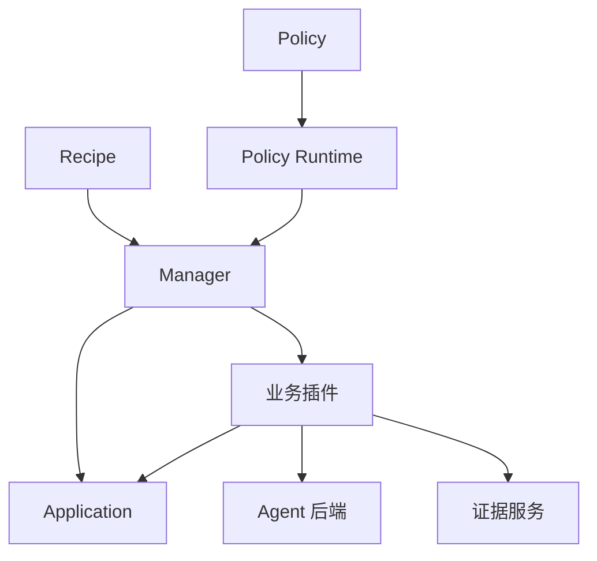
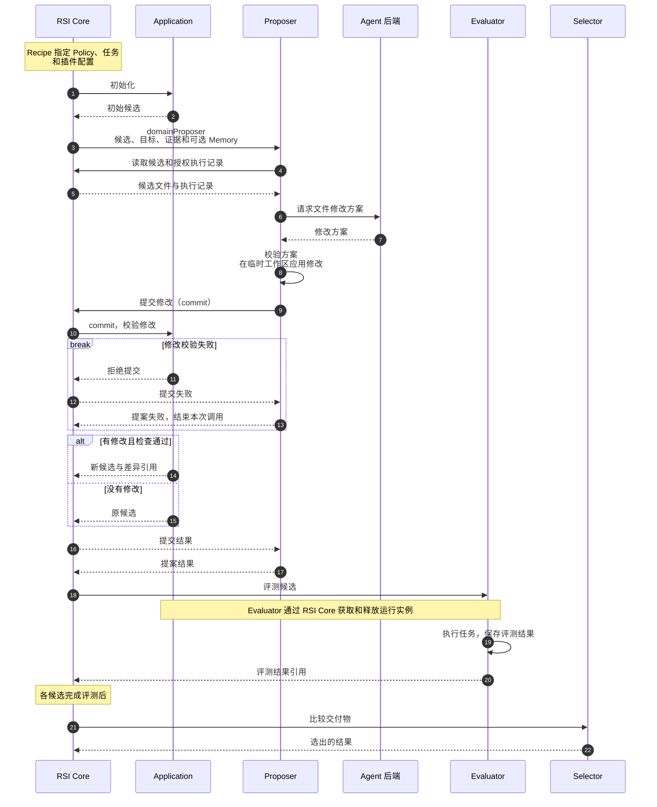

# 架构与核心概念

[English](architecture.md) | 简体中文 · [快速入门](../getting-started_zh.md)

ember-rsi（Recursive Self-Improvement）是面向 Agent 和 AI 基础设施的插件化自演进实验框架。

- Configuration（实验配置）指定要优化的对象、执行流程、插件和预算；
- RSI Core（执行核心）会根据配置运行并管理 Experiment（实验），记录实验状态与结果。
- 同一套 RSI Core 可以通过不同的 Configuration 运行不同的 Experiment。

## 核心概念

| 概念                           | 职责                                                                                |
| ------------------------------ | ----------------------------------------------------------------------------------- |
| Application（应用）            | 管理优化对象、允许的修改范围、候选初始化与提交，以及执行实例的获取和释放。          |
| Plugin（插件）                 | 实现提案、评测、选择、Memory 维护或 Reflection 提案生成等一项公开能力。             |
| Policy（策略）                 | 通过 YAML 数据流编排调用、状态、条件、循环和停止规则。                              |
| Recipe（实验配方）             | 选择 Application 和 Policy，提供配置与绑定，设置实验预算。                          |
| Runtime 与 Manager（执行核心） | 注册插件与 Policy、编译数据流；管理事实、预算、调用收据、实例租约、版本启用和恢复。 |

## Contract、Schema 与 Binding

> Contract、Schema 与 Binding 用于解耦 Policy 与具体插件实现，便于更换插件、调整配置，并在不同插件实现的实验中复用同一流程。

**Contract（契约）** 规定同一类插件接收什么输入、返回什么结果，并通过 Schema 定义这些数据的字段、类型和约束。具体如何完成从输入到输出，这个处理逻辑由插件实现。

- 插件声明所遵循的[公共契约](../../../src/contracts/plugin-types/index.ts)，Runtime 据此校验输入输出，使同一 Policy 中可以在符合契约的插件实现之间切换。

- 例如，[`contract.proposer`](../../../src/contracts/plugin-types/proposer.ts) 约定：输入为：父候选、目标和证据引用；输出为：候选引用及修改结果。

**Schema（数据结构规则）** 描述字段、类型、必填项和取值约束。当前有 JSON / YAML 声明和 TypeScript 直接定义 Schema 对象两种写法，均采用 JSON Schema 规则。

- Runtime 据此校验实际数据，而 TypeScript 类型用于编译期检查。
- 常见 Schema 种类如下：

  | Schema                        | 定义方       | 用途                                         |
  | ----------------------------- | ------------ | -------------------------------------------- |
  | 插件输入／输出                | 公共契约     | 规定同一能力的所有实现共同接收和返回的数据。 |
  | 插件配置                      | 具体插件实现 | 规定该实现接受哪些配置，以及已声明的默认值。 |
  | Policy 输入／配置／状态／输出 | Policy       | 规定流程接收、维护和返回的数据。             |

**Binding（绑定）** 将 Policy 中的逻辑名称连接到已注册的插件实现及其配置，而Binding 中的 `config` 字段用于配置实现。

- 例如，`require.domainProposer` 要求 `contract.proposer`。这个动作可以绑定 `proposer.agent`，通过模型生成提案；也可以绑定遵循同一契约的自定义插件，通过规则生成提案，无需修改 Policy 流程。

## Candidate、Artifact 与 Measurement

流程通过共享数据模型传递优化对象和结果：

| 概念                | 含义                                                                                                                                        |
| ------------------- | ------------------------------------------------------------------------------------------------------------------------------------------- |
| Candidate（候选）   | 优化对象的一个版本。同时关联该版本保存的文件或配置，并记录父候选和所属实验。 由 Application 负责初始化和提交候选，Manager 管理候选记录。 |
| Artifact（制品）    | 不可变的已保存内容。例如 JSON 文档或文件树快照。候选文件、Memory 和证据内容都可以保存为制品。                                               |
| Measurement（测量） | 与候选关联的评测记录，包括执行状态、覆盖率、评测条件、指标和证据引用。                                                                      |

步骤之间传递 `candidateRef`、`artifactRef`、`measurementRef` 等标识，分别用来找到对应的候选、保存内容和评测记录。数据定义见 [Candidate 模型](../../../src/contracts/models/candidate.ts)和 [Measurement 模型](../../../src/contracts/models/measurement.ts)。

## RuntimeContext

**RuntimeContext（运行上下文）** 是插件访问 Runtime 服务的入口，通过 `execute(input, context)` 的 `context` 参数传入。它提供当前实验、调用信息和取消信号，以及读取数据、管理工作区、调用其他插件等能力。

例如，`candidateRef` 是候选记录的标识，插件通过 `context.readCandidate(candidateRef)` 读取对应记录。完整接口见[使用 RuntimeContext](../guides/writing-plugins_zh.md#使用-runtimecontext)和 [Runtime 服务接口](../../../src/contracts/runtime/services.ts)。

## Evidence

**Evidence（证据）** 是运行过程中保存的执行轨迹、日志、交付物等材料，为后续分析、学习和选择提供依据。Runtime 为声明不同证据视图的插件提供不同的输入内容：

| 视图               | 视图提供的内容                                                                  |
| ------------------ | ------------------------------------------------------------------------------- |
| `execution`        | 脱敏执行证据，排除结构化评测分数、Reward 和判题反馈。                           |
| `training-summary` | 执行证据，加上训练分数和有界评测反馈。                                          |
| `delivery`         | 被记录为交付物的内容预览，例如 `report.md` 的内容；不提供执行轨迹和结构化评分。 |

因此插件在编写时，可以通过 [Runtime 证据服务](../../../src/runtime/services/facts/evidence.ts) 向优化模型提供输入，读取接口与限制见[编写插件](../guides/writing-plugins_zh.md)。

## 插件级自进化

框架提供 Memory、Reflection 等插件级自进化组件。选用已接入这些组件的 Policy，并配置相应的插件绑定、学习目标和授权资源，即可在实验流程中使用。

具体配置与更新生效方式见 [Memory 使用指南](../guides/memory_zh.md)和 [Reflection 使用指南](../guides/reflection_zh.md)；可用实现见[内置组件](../guides/built-in-components_zh.md)。

## 执行链路

以 [Harness² Policy](../../../src/policies/harness2/policy.yaml) 为例，`domainProposer` 负责提出领域相关的改进，默认使用 `proposer.agent` 插件。下图展示从初始化到评测和选择的主要调用链路：

图中的 RSI Core 包括 Policy Runtime 和 Manager。Policy Runtime 按 Policy 推进流程，Manager 检查预算，并保存候选、评测结果和调用记录。

对应源码见 [Proposer 契约](../../../src/contracts/plugin-types/proposer.ts)、[实现](../../../src/plugins/proposer-agent/service.ts) 和 [共享编辑配置](../../../src/plugins/shared/agent-editing/schema.ts)。
