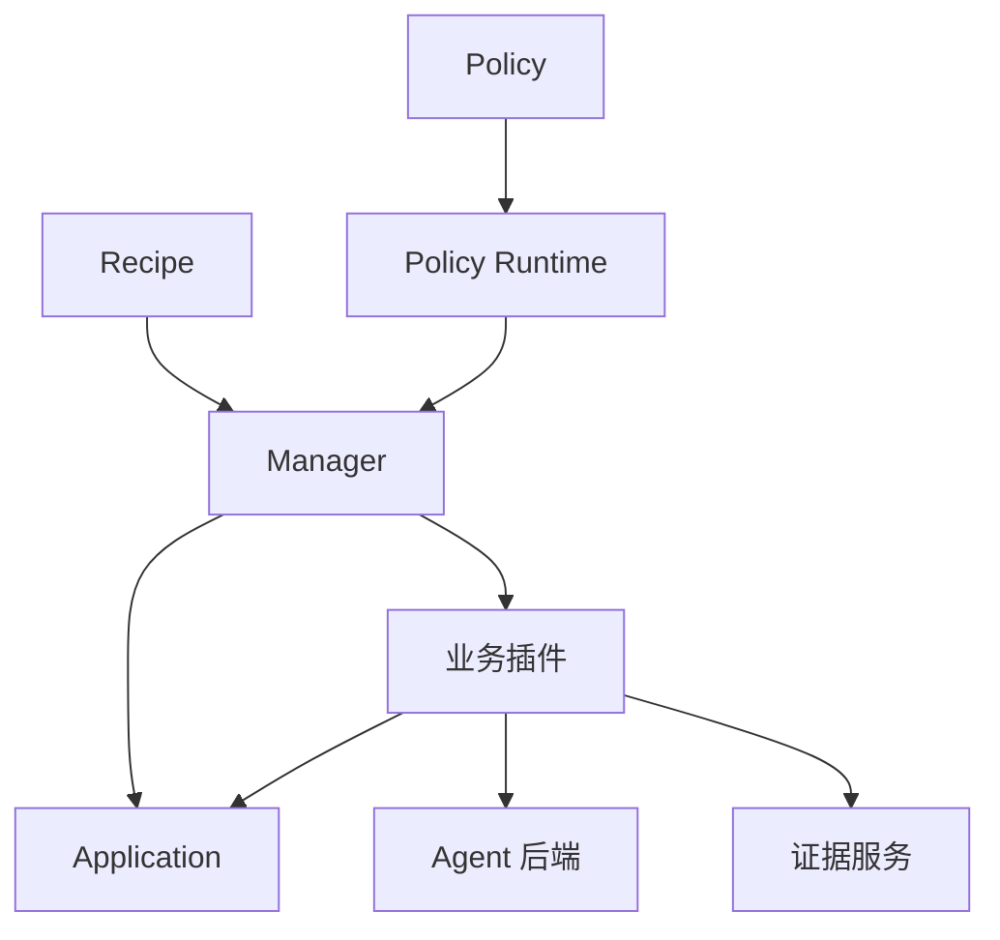

# ember-rsi 用户指南

[English](../en/guide.md) | 简体中文 · [Reflection](reflection.md) · [运行时事件](runtime-events.md) · [参数搜索](parameter-search.md)

ember-rsi（Recursive Self-Improvement）是面向 Agent 和 AI 基础设施的插件化自演进实验框架。本文描述当前源码提供的接口。Evaluator SDK 来自固定提交的 [ember-evaluator](https://github.com/evolving-foundry/ember-evaluator)，由 pnpm 安装并构建；依赖名及导入名统一为 `ember-evaluator`，无需同级 Evaluator 源码目录。请先按 [安装说明](../../../README.zh-CN.md) 准备环境，再从仓库根目录执行下文命令。

## 1. 核心概念与执行链路

| 概念                    | 职责                                                                    |
| ----------------------- | ----------------------------------------------------------------------- |
| Application（优化目标） | 管理优化目标、候选初始化与提交，以及执行实例的获取和释放。              |
| Plugin（插件）          | 实现提案、评测、选择、Memory 维护或 Reflection 提案生成等一项公开能力。 |
| Policy（策略）          | 通过 YAML 数据流编排调用、状态、条件、循环和停止规则。                  |
| Recipe（实验配方）      | 选择 Application 和 Policy，提供配置与绑定，设置实验预算。              |
| Runtime 与 Manager      | 注册和编译能力；管理事实、预算、调用收据、实例租约、版本启用和恢复。    |

一个插件实现一个 [公共契约](../../../src/contracts/plugin-types/index.ts)。契约定义输入输出 Schema；插件实现定义自己的配置 Schema 和 `execute(input, context)` 方法。不同绑定可以使用相同实现和不同配置。



以 [Harness² Policy](../../../src/policies/harness2/policy.yaml) 中绑定到 `proposer.agent` 的 `domainProposer` 为例：

1. Recipe 选择 `policy.harness2`，传入任务 ID 和初始候选。
2. `require.domainProposer` 声明需要 `contract.proposer`；`defaults.bindings.domainProposer` 选择实现和静态配置。
3. 声明 `type: invoke` 与 `use: domainProposer` 的步骤通过 `with` 传入动态输入：父候选、目标、证据引用及可选的 Memory 引用。
4. Proposer 读取父候选和授权证据，组装提示词与资源，再通过 `agentRef` 调用所选 Agent 绑定。
5. Proposer 在临时工作区应用经过校验的编辑，并调用 Application 的 `commit` 动作。Application 执行 Target 检查，返回候选与差异引用，或返回无修改结果。
6. 后续 Evaluator 和 Selector 测量候选并选择结果，Manager 保存对应事实和收据。

对应源码见 [Proposer 契约](../../../src/contracts/plugin-types/proposer.ts)、[实现](../../../src/plugins/proposer-agent/service.ts) 和 [共享编辑配置](../../../src/plugins/shared/agent-editing/schema.ts)。

### Target 与证据

对于文件型 Application，[Target](../../../examples/harness/dsh-harness2/target.yaml) 定义允许的文件模式、操作、编码与大小限制、保护路径以及一次提交的修改总量限制。候选编辑必须通过这些检查。

证据服务向模型插件提供以下投影：

| 视图               | 预期输入                                                                 |
| ------------------ | ------------------------------------------------------------------------ |
| `execution`        | 脱敏执行证据，排除结构化评测分数、Reward 和判题反馈。Harness² 用它学习。 |
| `training-summary` | 执行证据，加上训练分数和有界评测反馈。WikiSkill 用它学习。               |
| `delivery`         | 用于交付物选择的匿名内容，不包含评测分数。                               |

应通过 [Runtime 证据服务](../../../src/runtime/services/facts/evidence.ts) 向优化模型提供输入，而不是直接传入原始评测记录。投影可能省略或缩短内容，缺失证据仍应视为未知。这些服务和 Target 检查不构成任意第三方插件代码的沙箱；Policy 也必须避免将独立测试任务用于学习。

### Memory 与 Reflection

Memory 将经验保存为制品引用，并存入 `state.wikiRef` 等实验状态。后续调用通过 `memoryRef` 接收它；仅写入 Memory 不会让所有插件自动使用经验。

Reflection 为授权的插件资源提出修改。Runtime 校验、持久化并启用**当前实验内**的新版本。只有后续调用读取并使用新资源，修改才参与执行。新实验不会自动继承这些版本，源 Policy 文件也不会被覆盖。

Harness² 声明了 Reflection 配置，但其 `improve_guidance` 步骤目前被注释，默认不会执行 Reflection。显式调用与持久化行为见 [Reflection 指南](reflection.md)。

## 2. 运行与观察实验

### 环境与模型

请按 [README](../../../README.zh-CN.md) 准备源码安装、Docker、基准任务下载与镜像，以及模型访问条件。宿主和评测容器都使用同一模型服务时，两者都必须能访问该地址。

```sh
export MODEL_NAME="your-optimizer-model"
export EVALUATOR_MODEL_NAME="your-evaluation-model"
export MODEL_ENDPOINT="https://your-model-service.example/v1"
export MODEL_API_KEY="your-api-key"
```

RSI 不会自动加载 `.env` 文件。请在启动 CLI 或 Web 服务的进程环境中导出变量。`agent.pi` 在执行时解析模型字段；API Key 配置使用环境变量引用，而非明文密钥。

优化器 Agent 和被评测的 Solver 可以使用不同模型。Harness² Recipe 中的 `bindings.evaluator.config.services.default.model` 读取必填的 `EVALUATOR_MODEL_NAME` 环境变量，与 `MODEL_NAME` 独立，没有固定默认值。

[Agent 配置 Schema](../../../src/plugins/agent-pi/schema.ts) 默认设置为 `thinkingLevel: low`、`maxTokens: 32768`、`contextWindow: 262144`、`timeoutMs: 600000` 和 `retries: 0`。可以显式指定 `thinkingLevel: off`。请选择模型端点支持的限制和思考设置。这些默认值配置 RSI 的 Agent 后端，不设置被评测 Solver 的思考行为。

所有 `agent.pi` 会话默认提供 `run_subagent`，子代理也可继续委派。各 Agent 自主决定是否委派及如何分工，不额外限制委派层数或子代理数量；各层共用 Runtime 预算和取消机制，启动子代理不会重置预算。子代理使用同一 Agent 绑定，拥有独立对话和明确传入的虚拟文件。详见 [Reflection 机制](reflection.md#reflection-机制)。

### Recipe 配置

从完整示例开始，保持 `recipe.yaml`、`target.yaml` 和 `baseline/` 配套。相对资源路径以声明该路径的文件为基准解析。以下是仅含一个任务的 Harness² Recipe：

```yaml
schemaVersion: rsi.recipe/v1
id: harness2-one-task
application:
  plugin: application.agentbundle
  config:
    target: { schema: ./target.yaml }
    baseline: { directory: ./baseline }
policy:
  id: policy.harness2
  input:
    candidateRef: ${{ application.initialCandidate }}
  config:
    k: 1
    concurrency: 2
    memory: true
    dataset:
      taskIds:
        - workbuddy/board-material-update-timeline-excel
bindings:
  agent:
    plugin: agent.pi
    config:
      thinkingLevel: low
  evaluator:
    plugin: evaluator.agentbench
    config:
      services:
        default:
          model: ${EVALUATOR_MODEL_NAME}
          maxTokens: 65536
          base_url: ${MODEL_ENDPOINT}
          api_key: ${MODEL_API_KEY}
      benchmark:
        name: workbuddy
        scenario: office
        solver:
          name: agentbundle
      scheduler:
        name: local
        concurrency: 1
      run:
        timeoutSeconds: 4500
budget:
  operations: 1400
  evaluationRuns: 4
  modelCalls: 1400
  elapsedWallMs: 259200000
  cleanupReserveMs: 60000
```

将它放在 [Harness² 基线和 Target](../../../examples/harness/dsh-harness2/README.md) 旁边，并将模型替换为端点支持的模型。评测模型必须支持配置的输出上限。预算是上限，不是预期用量或费用估计。

Harness² 的 `policy.config` 接受 `k`、`concurrency`、`dataset.taskIds` 和 `memory`。目标与交付物评分标准由 Policy 定义，不能通过 `goals` 或 `deliveryRubric` 配置。`k` 控制探索槽位数。`concurrency` 限制每个阶段的 Policy 分支并发数，默认为 `2`。INV 和 DOM 在同一阶段提案，全部提案完成后进入评测阶段。Compose 等待两路评测完成。设为 `concurrency: 1` 时，各阶段内部串行执行。Evaluator 调度器另有并发设置。Base、INV、DOM 和 Compose 共调用 Evaluator `4 × k × 任务数` 次。

[WikiSkill](../../../examples/harness/dsh-wikiskill/README.md) 接受 `maxRounds`、可选的 `stopAtScore`，以及 `dataset` 下互不重叠的 `trainTaskIds`、`validationTaskIds` 和 `testTaskIds`。它从训练证据学习，通过验证集测量决定候选是否被接受，并在学习循环之后评测独立测试任务。其 Recipe 使用 `linux/amd64` 任务镜像，ARM64 宿主也一样；仍需满足 Docker、模拟执行和基准环境要求。调整字段前请核对 [当前 Recipe](../../../examples/harness/dsh-wikiskill/recipe.yaml) 和 [Policy Schema](../../../src/policies/wikiskill/schemas/wikiskill-config.yaml)。

### CLI

```sh
ember-rsi validate examples/harness/dsh-harness2/recipe.yaml
ember-rsi run examples/harness/dsh-harness2/recipe.yaml --id my-harness2-task
ember-rsi list
ember-rsi show my-harness2-task
ember-rsi cancel my-harness2-task
ember-rsi catalog
```

`validate` 检查配置、契约、绑定及声明的 Reflection 资源，不调用模型、不准备基准镜像，也不证明模型、网络或硬件已就绪。有效 Recipe 仍可能在执行中失败。`cancel` 发出取消请求，之后应检查已保存的状态。

使用相同工作目录、Recipe 和实验 ID 恢复中断的实验：

```sh
ember-rsi run examples/harness/dsh-harness2/recipe.yaml --id my-harness2-task --resume
```

默认存储位于当前目录的 `.rsi/`。已完成调用可以复用收据和检查点；外部操作结果未知时需要核对，不能据此承诺所有操作只执行一次。应分别查看状态、测量和证据，零分不一定表示执行失败。`agent.pi` 的模型输出纠错有次数限制，并计入模型调用预算；未显式配置时不进行传输重试。

### Web 观察

```sh
ember-rsi serve --port 4317
```

打开 `http://127.0.0.1:4317`。构建后的 Web 是**只读观察工作区**，展示实验列表、摘要、候选、测量、调用和图表。请通过 CLI 启动、恢复和取消实验；当前 UI 没有 Recipe 编辑器、启动或取消按钮。CLI 和服务端即使是不同进程，只要从相同目录启动，就使用同一磁盘存储。

`pnpm dev:web` 启动 Vite 开发模式，默认将 `/api` 代理到 4317 端口，需要后端配合；`serve` 提供构建后的静态资源。服务监听回环地址并检查 Host/Origin，不提供面向公网部署的用户认证。

## 3. 定制绑定与插件

### 选择扩展边界

| 需求                                               | 扩展方式                                            |
| -------------------------------------------------- | --------------------------------------------------- |
| 修改任务、限制、模型或现有提示词路径               | 覆盖对应的 Recipe 配置或绑定。                      |
| 替换推理和工具执行，复用 Proposer 的证据与编辑处理 | 实现 `contract.agent` 并替换 `agent` 绑定。         |
| 替换完整的提案流程                                 | 实现 `contract.proposer` 并替换对应 Proposer 绑定。 |
| 修改编排、状态或停止规则                           | 注册自定义 Policy。                                 |

绑定声明通过 `plugin` 选择已注册插件，`policy.id` 选择已注册 Policy。仅含配置的覆盖项继承默认插件；插件不变时，普通对象递归合并，数组、标量和 null 替换旧值。切换插件会丢弃原插件配置。Schema 标记的路径字段分别保留其声明来源。加载时校验最终配置与契约。参考 [加载器](../../../src/runtime/loaders/index.ts)。

插件按 `schema.ts`（配置）、`service.ts`（业务逻辑与清理）、`index.ts`（组装定义）组织，复用公共契约的输入输出 Schema。仓库内插件导入本地契约；外部工程从 `ember-rsi` 或 `ember-rsi/contracts` 导入，不使用私有 `src/*` 子路径。

自定义 Agent 必须返回符合请求中 `input.outputSchema` 的对象，限制可用工具和文件，传递取消信号，以 `context.charge('modelCalls', 1)` 为实际模型尝试记账，并释放资源。实现 Agent 契约不会自动让任意后端校验请求中的输出 Schema；后端需要执行该校验。内置 Proposer 的编辑协议见 [共享编辑代码](../../../src/plugins/shared/agent-editing/index.ts)。

### 为 CLI 注册外部扩展

默认扩展从 `~/.ember-rsi/plugins/<name>/index.mjs` 按名称顺序加载，之后加载额外的 `--plugin-dir` 目录。主目录不存在时正常启动；已发现的扩展无效时启动失败。实验数据仍在工作目录的 `.rsi/`。嵌入宿主可设置 `homeDirectory: false` 隔离本机扩展。

`ember-rsi list plugins` 和 `ember-rsi list policies` 提供描述、输入/输出/配置 Schema、contract 及兼容绑定位置。兼容表示 contract 匹配，不保证适用于当前任务。`ember-rsi list` 仍列出实验，`ember-rsi catalog` 仍返回简洁的 ID 列表。

所有 CLI 命令都接受可重复的 `--plugin-dir <directory>`。每个目录包含 ESM 文件 `index.mjs`，导出 `register(registry)`。扩展及其依赖必须提前构建，并能在加载时被解析：

```js
// my-extension/index.mjs
import { myAgentDefinition } from './agent.js';

export function register(registry) {
  registry.registerOperation(myAgentDefinition);
}
```

在 Recipe 中设置 `bindings.agent.plugin: agent.my-custom`，与插件定义 ID 一致；需要扩展的命令都传入该目录：

```sh
ember-rsi validate ./my-recipe/recipe.yaml --plugin-dir ./my-extension
ember-rsi run ./my-recipe/recipe.yaml --id custom-run --plugin-dir ./my-extension
```

仓库内置扩展则需将定义加入 [registerBuiltins](../../../src/runtime/builtins.ts) 并重新构建。仅创建源码文件不会注册插件。

### 嵌入 Runtime

外部宿主可以直接注册定义。校验和执行所用 Runtime 必须具有相同的注册内容：

```ts
import { resolve } from 'node:path';
import { createRuntime, validateRecipe } from 'ember-rsi';
import { myAgentDefinition } from './plugins/agent-custom/index.js';

const runtime = await createRuntime({ rootDirectory: process.cwd() });
try {
  runtime.registry.registerOperation(myAgentDefinition);
  const recipePath = resolve('./my-recipe/recipe.yaml');
  const check = await validateRecipe(runtime, recipePath);
  console.log(check);
  const result = await runtime.manager.run(recipePath, { id: 'custom-run' });
  console.log(result.status, result.output);
} finally {
  await runtime.dispose();
}
```

`Recipe.load(recipePath, runtime.registry)` 返回装配后的定义，不会初始化 Application。其 `policy` 是 `Policy` 对象，`policyConfig` 与 `policyInput` 分别保存配置和输入映射。`application` 与 `bindings` 中各项是已校验的 `Binding` 对象，提供 `pluginId` 与 `config`；`toJSON()` 导出使用 `plugin` 与 `policy.id` 的声明。使用这些模型 API 时，从 `ember-rsi` 导入 `Recipe`、`Policy` 与 `Binding`。

宿主进程直接注册插件，不会修改另行启动的 CLI 进程。请通过该宿主管理实验，或通过 `--plugin-dir` 加载相同扩展。不要将存活的 `RuntimeContext` 对象作为 JSON 持久化。

## 4. 编写 Policy

Policy 使用 `rsi.policy/v1`，Recipe 使用 `rsi.recipe/v1`。Policy 声明输入、输出和配置 Schema、依赖的契约 ID、可选的默认绑定，以及执行流程。参考 [Harness²](../../../src/policies/harness2/policy.yaml)、[WikiSkill](../../../src/policies/wikiskill/policy.yaml) 和 [Policy 编译器实现](../../../src/runtime/compiler/)。

所有步骤在统一的顶层 `steps` 数组中依次执行，逐项声明 `id` 与 `type`。使用共享状态时，需显式声明 `state_schema` 和初始 `state`；初始化表达式可引用已校验的 `input`、`application` 与 `config`。

| 类型         | 行为                                                                 |
| ------------ | -------------------------------------------------------------------- |
| `invoke`     | 通过 `use` 与可选的 `with` 调用依赖插件绑定。                        |
| `state`      | 原子校验并提交共享状态更新；并行分支禁止写入。                       |
| `if`         | 选择 `{ steps, output? }` 形式的 `then` 或 `else` 块。               |
| `loop`       | 通过 `maxIterations`、可选 `while` 执行有界循环，支持可选 `output`。 |
| `foreach`    | 使用稳定且唯一的键、有界并发和可选逐项 `output` 遍历。               |
| `control`    | 执行 `break`、`continue`，或附带原因的 `fail`。                      |
| `reflection` | 串行调用已声明的 Reflection 模块。                                   |

`${{ input.candidateRef }}`、`${{ steps.propose.output.candidateRef }}` 等表达式通过有界纯表达式连接数据。`steps` 按词法作用域读取已完成步骤，`loop.index` 表示最近一层循环的索引。if/foreach 的输出在局部块内求值，loop 的输出在循环外求值；后续需要的逐轮结果应保存在已声明状态中，并覆盖零轮循环。状态更新的右侧表达式读取更新前的状态。

典型搜索先评测基线，再循环提案、评测和选择，保存被接受的状态，最后通过普通后续步骤评测独立测试集。并行 foreach 分支返回输出，交给后续串行步骤汇总。Reflection 使用 `type: reflection`，不能在并行分支执行。绑定只选择插件，不支持子 Policy、固定的 `init`/`finish` 作用域或 Runtime 报告阶段标签。成功、失败和取消时的资源清理由 Runtime 负责。

从构建后的扩展注册自定义 Policy（下列路径相对于扩展模块）：

```js
import { fileURLToPath } from 'node:url';
import { Policy } from 'ember-rsi';

export async function register(registry) {
  const file = fileURLToPath(new URL('./policy.yaml', import.meta.url));
  const policy = await Policy.load(file, registry);
  registry.registerPolicy(policy.id, file);
}
```

读取依赖自定义契约的 Policy 前，先注册相应插件定义。Recipe 引用已注册的 Policy ID，并提供全部必需绑定。修改源码后运行 `pnpm build`；工程验证使用现有 `pnpm check` 入口。真实模型和基准实验与确定性检查分别进行。

## 5. 使用 AI Skill

仓库提供 [skills/ember-rsi](../../../skills/ember-rsi/SKILL.md)，用于配置实验、开发插件和诊断运行。将它提供给编程助手，并要求助手在使用示例前核对目标检出的接口；部分引用已明确标记为历史资料。

可以提出以下请求：

- 复制一份单任务 Harness² Recipe，选择支持的优化器与评测模型，重算预算，只做校验而不启动真实实验。
- 实现 `contract.agent`，注册扩展，并将其绑定到 Harness² 的 `agent` 槽位。
- 检查实验收据与证据，解释哪些编辑被接受、为什么选择某份交付物，并区分执行失败与低分。
